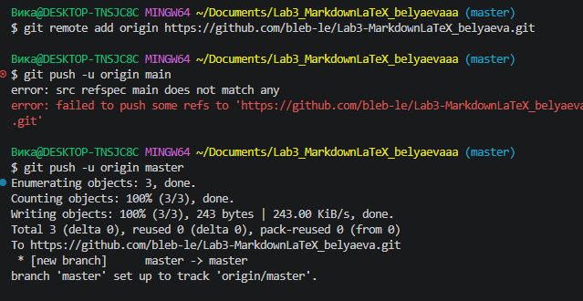

# Лабораторная работа №3: Markdown и LaTeX

Краткое описание: Данный проект создан для демонстрации навыков работы с разметкой Markdown и базового использования LaTeX в документации. В ходе работы были изучены заголовки, списки, таблицы, ссылки, цитаты и математические формулы!

## Содержание
- [Структура проекта](#структура-проекта)
- [Форматирование текста](#форматирование-текста)
- [Примеры возможностей](#примеры-возможностей)

---

## Структура проекта
* Папка `docs` — для Markdown-файлов
  + Вложенная папка для примеров
- Папка `img` — для скриншотов
* Папка `latex` — для примеров формул

---

## Форматирование текста
Здесь показаны примеры:
+ **Полужирный текст**
+ *Курсив*
+ ~~Зачёркнутый~~
+ `Моноширный текст`

### Списки
1. Нумерованный элемент 1
2. Нумерованный элемент 2
   * Маркированный подпункт
   * Еще один подпункт

### Цитата
> это пример цитаты в Markdown

### Таблица

| Название | Команда | Описание |
| :--- | :---: | ---: |
| Инициализация | `git init` | Создание репозитория |
| Статус | `git status` | Проверка состояния |
| Отправка | `git push` | Загрузка на сервер |

### Изображение из папки img/



### Ссылки (внешняя и внутренняя)

* [Внешняя ссылка на GitHub](https://github.com)
* [Внутренняя ссылка на блок кода](#блок-кода)

### Чекбоксы

- [x] Task 1
- [ ] Task 2

### Сноска (в стиле GitHub)

Текст со сноской[^1]

[^1]: Примечание к сноске.

### Alert-блоки GitHub

> [!NOTE]
> Это простая заметка.

> [!TIP]
> Это полезный совет.

> [!WARNING]
> Это предупреждение.

### Inline LaTeX

Площадь круга: $S = \pi r^2$

### Block LaTeX

$$
\sum_{i=1}^n i = \frac{(n+1)}{2}
$$

### Блок кода
```bash
git status
git add .
git commit -m "Пример"